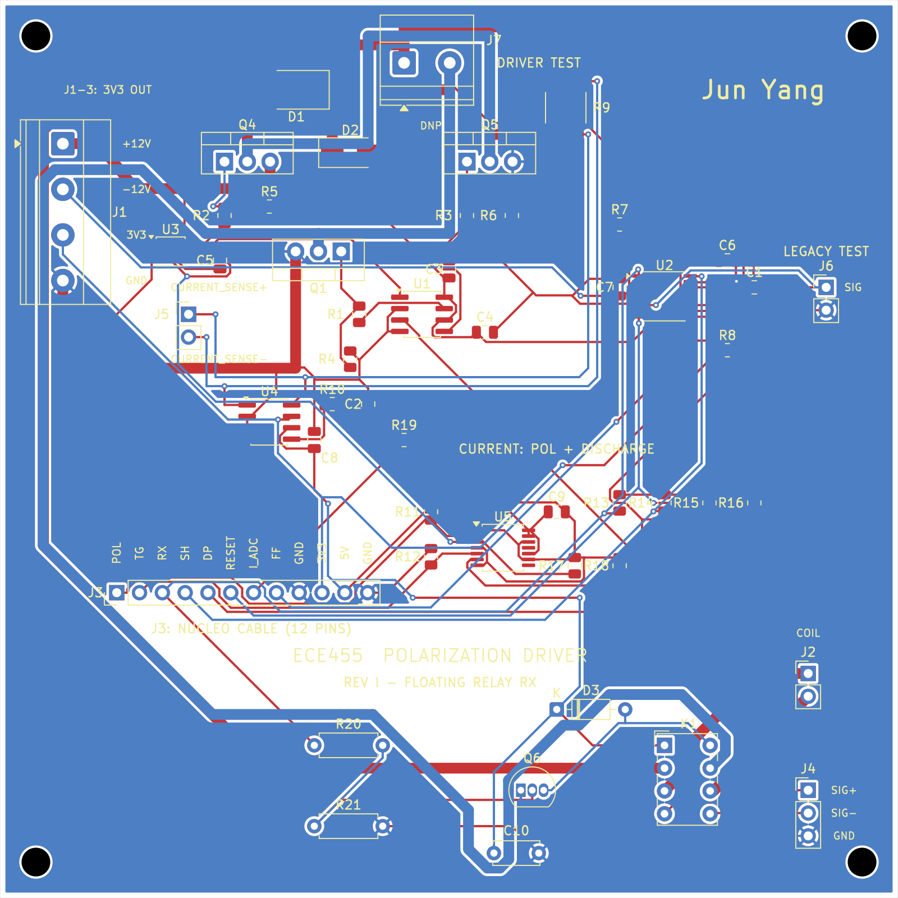

# Mag-4

ECE 455 final project: a proton-precession magnetometer.

This repo contains the polarization coil driver design. The driver powers the coil, discharges it, and switches it to the receiver for measurement. It connects to a NUCLEO-F446RE.

## Files

- [Latest PCB — Rev I](hardware/pcb/rev-i/): KiCad schematic and board, BOM, Gerbers, and schematic PDF.
- [Previous KiCad versions](hardware/pcb/previous-versions/): early AWG19 designs, Rev D through Rev H, and the draft relay adapter.
- [LTspice — Rev G](simulation/ltspice/rev-g/): simulation files, results, and Python analysis script.
- [Firmware](firmware/): still to be added.

Open the `.kicad_pro` files in KiCad 10. Keep the included symbols and footprints with each project. For simulation, open the `.asc` file in LTspice.

Rev I is the current 100 × 100 mm board. Hardware testing and receiver integration are still in progress. The Rev G simulation does not include the Rev I relay changes.

